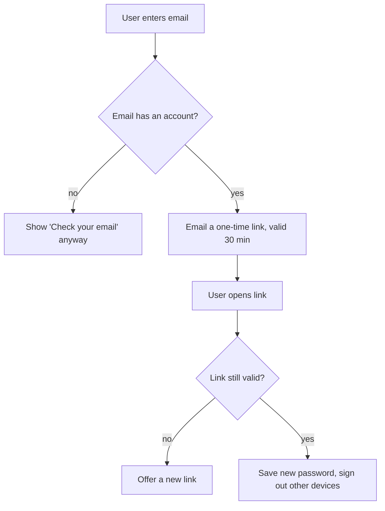

# Flows and diagrams

Read whenever a document contains a flow, a request path, a site map, or any diagram.

## Ask how to deliver it

Ask each time, with a recommendation:

- **tldraw canvas:** best for discussing a flow with others, rearranging it, or commenting on it
- **Markdown file:** best for reading in a repo or a docs tool, and for a reader without tldraw
- **Both:** the canvas for discussion, the file as the record

If the user doesn't want tldraw, or it isn't available, write the Markdown file.

## Check tldraw is available

Two things are needed:

1. **The tldraw skill.** It is listed among the available skills as `tldraw-offline`, or exists at `~/skills/tldraw-offline/SKILL.md`.
2. **The tldraw offline desktop app is running.** Its local server answers, as described in that skill.

If the skill is missing, tell the user:

> To draw this on a canvas, install tldraw offline (the free desktop app) from https://offline.tldraw.com. Open it, choose Develop → Install Agent Skills, then restart this session.

Then offer the Markdown file meanwhile.

If the skill is there but the app isn't running, ask the user to open the app.

## Drawing on tldraw

Load the `tldraw-offline` skill and follow it for every app call. It ships with the app and changes with it, so its instructions win over anything here.

What this skill adds:

- **New canvas.** Create a new document named after the doc, such as "Password reset flow". Don't draw on a canvas the user already has open unless they ask. Why: it may hold someone else's work.
- **Mermaid.** Generate the diagram from Mermaid source with the app's mermaid helper. Don't place boxes by hand. Why: generated diagrams get real connected arrows and a tidy layout.
- **Labels.** Write every label in plain English. Use steps that start with a verb ("User enters email"), and decisions written as questions ("Email registered?"). Label each decision arrow "yes" or "no".
- **Stop at the zoom that answers the question.** A system overview is usually the system and its neighbours, then its running parts. Draw deeper only for a question the reader has. Why: each level down adds boxes the reader did not ask about.
- **One diagram, one flow.** For two flows, draw two diagrams side by side, or put each in a Mermaid `subgraph`.
- **Check it.** Run the app's lint check and fix what it reports. Save the document. Take one screenshot to confirm a reader can follow it.
- **Report** the canvas name and file path in the reply.

## Writing a flow in Markdown

Plain-English steps come first, so anyone can read the flow without a diagram. Add a Mermaid block after them only when the reader's tool renders Mermaid (GitHub and GitLab do).

```markdown
## Flow: Reset a forgotten password

**Who:** a signed-out user.
**Starts when:** they click "Forgot password" on the sign-in page.
**Ends when:** they are signed in with a new password.

1. The user enters their email address.
2. The system checks whether that email has an account.
   - If it doesn't: show the same "Check your email" message anyway, so no one can find out which emails have accounts. The flow ends here.
3. The system emails a reset link. The link works once, for 30 minutes.
4. The user opens the link and chooses a new password.
   - If the link has expired: show "This link has expired" and offer to send a new one.
5. The system saves the new password, signs the user out on every other device, and signs them in here.

**What can go wrong:** the email never arrives. The user can ask for another link after 1 minute.
**Data touched:** the user's password hash. The reset token is deleted once it is used.
```

Mermaid version of the same flow:



## Rules for every flow

- Say who acts in every step: "the user", "the system", "the payment provider".
- Each step does one thing. A step that needs "and then" is two steps.
- Write each branch where it happens. Say where it goes next, or that the flow ends.
- Name what is stored or changed, and what the user sees when something fails.
